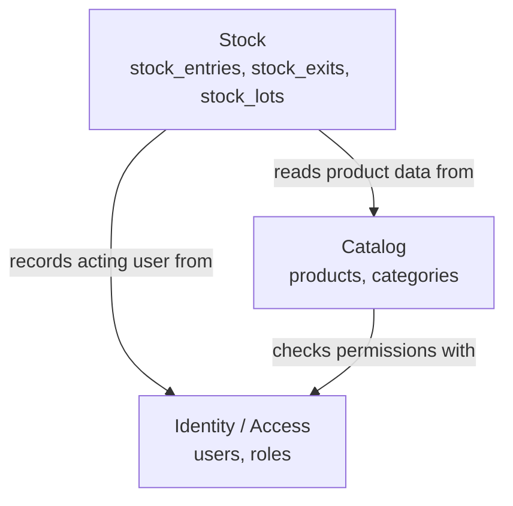

# 02 — Domain Map

## Bounded contexts

## Relationship legend

| Arrow | Meaning |
|---|---|
| `reads product data from` | Read-only lookup; Stock validates that the product exists and is active. `product_id` is a plain column, not a foreign key |
| `records acting user from` | Each movement stores the `user_id` who made it. Stock owns no user data |
| `checks permissions with` | Catalog asks Identity whether the user may create or edit products |

## How this map is used

Every bounded context above becomes exactly one module in
[`module-boundaries.md`](./module-boundaries.md), owning the tables named here.

---

**Related:** [`./entities-and-rules.md`](./entities-and-rules.md) · [`./module-boundaries.md`](./module-boundaries.md)