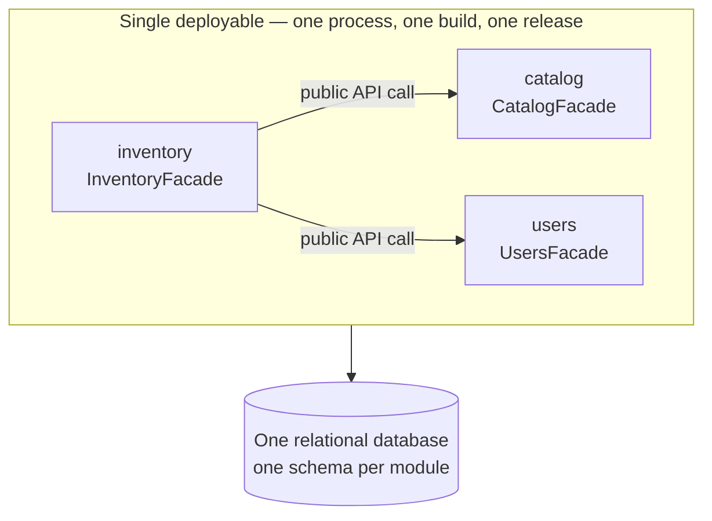

# 05 — Modular Monolith

## What it is

A **modular monolith** is one application that is built, deployed and released
as a single unit, but internally divided into modules. Each module has a
specific responsibility, owns its data and exposes only the functionality
needed by other modules.

For Inven-Track, the main modules are `catalog`, `inventory` and `users`.

## One deployment, three modules

The `catalog` module manages products and suppliers.

The `inventory` module manages entries, lots, outputs and inventory
movements. It uses the public APIs of `catalog` and `users` when it needs
information owned by those modules.

The `users` module manages application users and responsible users.

The modules do not access each other's internal implementation directly.
Communication between modules occurs through their public APIs.

## Anatomy of a module

| Part | Rule |
|---|---|
| Public API | One public entry point, such as `<Module>Facade`, used by other modules |
| Internal | Domain, application and persistence code used only inside the module |
| Owned tables | Written and maintained by the module that owns them |
| Tests | Public APIs are covered by integration tests and internal logic by unit tests |

## How modules talk, inside one process

| Mechanism | Use it when | What it is not |
|---|---|---|
| Public API call | A module needs information or an operation from another module | Not a network request — it is an in-process method call |
| In-process event | More than one module needs to react to an operation that already happened | Not a message broker or external queue |

For example, when `inventory` registers an entry, it can use the public API of
`catalog` to validate the product and supplier.

When an inventory operation needs to identify the responsible user, the
`users` public API can be used to validate that user.

These interactions remain inside the same application process.

## Module responsibilities

| Module | Responsibility | Main data |
|---|---|---|
| `catalog` | Products and suppliers | `products`, `suppliers` |
| `inventory` | Inventory entries, lots, outputs and movements | `entries`, `lots`, `outputs`, `inventory_movements` |
| `users` | Application users and responsible users | `users` |

Each module is responsible for its own data. Other modules should not directly
modify another module's tables.

## When it applies, and when it is over-engineering

| Situation | Verdict |
|---|---|
| Two or more bounded contexts on the domain map | Modular monolith |
| Different business areas need clear ownership of their data | Modular monolith |
| The application must remain a single deployable system | Modular monolith |
| One bounded context on the domain map | Use [`layered-architecture.md`](./layered-architecture.md) |
| Boundaries exist only because of technical folders | Not a module; it is a layer |
| A module has no clear business responsibility | Review the domain model before creating the module |

For the current Inven-Track structure, the modules are organized around the
main business responsibilities of the application rather than around
technical concerns.

The project remains a single application and does not require independent
deployments for each module.

---

**Related:** [`../02-domain/module-boundaries.md`](../02-domain/module-boundaries.md) · [`./boundary-enforcement.md`](./boundary-enforcement.md)
