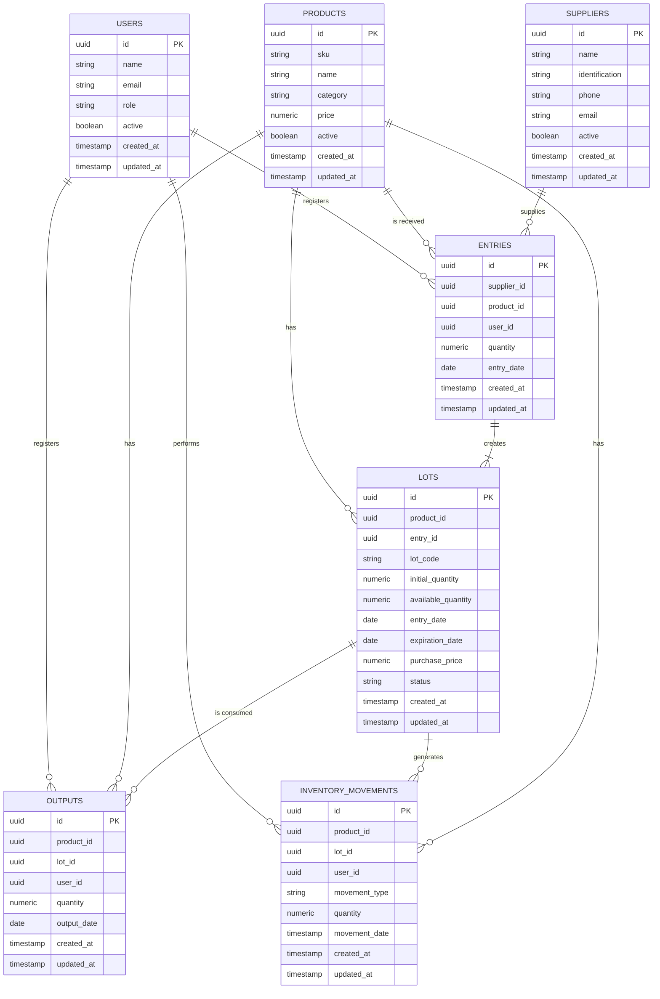

# 06 — Data Models

## Entities and ownership

| Entity | Table | Owning module | Key attributes |
|---|---|---|---|
| Product | `catalog.products` | `catalog` | sku, name, category, price, active |
| Supplier | `catalog.suppliers` | `catalog` | name, identification, phone, email, active |
| User | `users.users` | `users` | name, email, role, active |
| Entry | `inventory.entries` | `inventory` | supplier, product, quantity, entry date, responsible user |
| Lot | `inventory.lots` | `inventory` | product, entry, lot code, initial quantity, available quantity, entry date, expiration date, purchase price, status |
| Output | `inventory.outputs` | `inventory` | product, lot, quantity, output date, responsible user |
| Inventory movement | `inventory.inventory_movements` | `inventory` | product, lot, movement type, quantity, movement date, responsible user |

The data models in Inven-Track represent the main information required to
manage products, suppliers, inventory entries, lots, outputs and inventory
traceability.

## Relationships

The relationships represent the main inventory process of the salsamentaria:
products are received from suppliers, registered as entries, organized into
lots, consumed through outputs and recorded through inventory movements.

## Cross-module references

| Table | Column | Points to | Enforced by |
|---|---|---|---|
| `inventory.entries` | `supplier_id` | `catalog.suppliers` | Catalog application service, not a database foreign key |
| `inventory.entries` | `product_id` | `catalog.products` | Catalog application service, not a database foreign key |
| `inventory.entries` | `user_id` | `users.users` | Users application service, not a database foreign key |
| `inventory.lots` | `product_id` | `catalog.products` | Catalog application service, not a database foreign key |
| `inventory.outputs` | `product_id` | `catalog.products` | Catalog application service, not a database foreign key |
| `inventory.outputs` | `user_id` | `users.users` | Users application service, not a database foreign key |
| `inventory.inventory_movements` | `product_id` | `catalog.products` | Catalog application service, not a database foreign key |
| `inventory.inventory_movements` | `user_id` | `users.users` | Users application service, not a database foreign key |

The inventory module can reference products, suppliers and users, but it does
not directly modify records owned by those modules.

The corresponding application service validates that the referenced product,
supplier or user exists and is active before completing the inventory
operation.

Database-level foreign keys are not used between modules according to the
rules defined in `database-conventions.md`.

## Inventory and FIFO model

The `Product` represents the product managed by the salsamentaria, while the
`Lot` represents a specific quantity of that product received at a certain
time.

Each lot stores:

- `initial_quantity`: quantity received when the lot was created.
- `available_quantity`: quantity that remains available.
- `entry_date`: date when the lot entered the inventory.
- `expiration_date`: expiration date of the lot.
- `lot_code`: identifier assigned to the lot.
- `purchase_price`: purchase price associated with the lot.
- `status`: current status of the lot.

The FIFO rule uses the `entry_date` and `available_quantity` fields to
determine which lot must be consumed first.

For example:

- Lot J001: 20 kg, entered on 2026-09-10.
- Lot J002: 30 kg, entered on 2026-09-12.
- Lot J003: 25 kg, entered on 2026-09-15.

If an output of 25 kg is registered:

- J001 → 20 kg consumed.
- J002 → 5 kg consumed.
- J003 → 0 kg consumed.

Remaining quantities:

- J001 → 0 kg.
- J002 → 25 kg.
- J003 → 25 kg.

The user does not manually select the lot. Inven-Track determines which lot
must be consumed according to the FIFO rule.

## Expiration control

Expiration is managed at the lot level because different lots of the same
product can have different expiration dates.

The system uses `expiration_date` to identify:

- Lots that are close to expiration.
- Lots that have already expired.
- Lots that still have sufficient time before expiration.

This information is used by the expiration alert functionality of
Inven-Track.

## Inventory traceability

Inventory movements preserve the history of changes made to the inventory.

Each movement identifies:

- The product affected.
- The lot affected, when applicable.
- The quantity involved.
- The type of movement.
- The user responsible.
- The date and time of the operation.

Historical inventory movements should not be deleted during normal
operations. Corrections must be represented through a controlled movement
or adjustment according to the business rules of Inven-Track.

## Data consistency

The data model must maintain consistency between products, lots and inventory
movements.

The `available_quantity` of a lot must represent the quantity that can still
be used for future outputs.

An inventory output cannot consume more quantity than is available in the
corresponding lots.

A lot with zero available quantity cannot be used for a new output.

Expired lots must be identifiable through their `expiration_date` and must
be available to the expiration alert process.

The historical movement information must remain available to allow the
system to trace how inventory quantities changed over time.

---

**Related:** [`../02-domain/entities-and-rules.md`](../02-domain/entities-and-rules.md) · [`./database-conventions.md`](./database-conventions.md)
